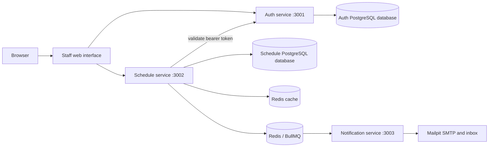

# Healthcare Scheduling MVP

A NestJS GraphQL backend for clinic scheduling, with separate authentication and scheduling databases, Redis caching, and email notifications via BullMQ and Mailpit.

## Branches

`develop` is the integration branch; `main` is the stable submission branch. See [the branching and release workflow](docs/branching.md) for branch naming, checks, and promotion.

## Run locally

Install Docker Desktop, copy `.env.example` to `.env`, then run:

```sh
docker compose up --build -d
```

Open the [clinic workspace](http://localhost:3000), the [Auth GraphQL endpoint](http://localhost:3001/graphql), [Schedule GraphQL endpoint](http://localhost:3002/graphql), and [Mailpit inbox](http://localhost:8025). Sign in with the demo credentials configured in `.env`. The `.env.example` settings are for local development only. For a quick API check, run `node scripts/mvp-smoke.mjs` while the stack is running; it creates a test user, customer and doctor, and creates and cancels a schedule.

## Architecture



Auth owns users and JWT verification; Schedule owns patients, doctors and appointments. A database constraint prevents concurrent double booking. Schedule changes and audit entries are transactional. Notifications are asynchronous and best-effort: if the queue is unavailable when an appointment changes, its email is not retried unless a job was successfully enqueued.

## Environment variables

Copy `.env.example` to `.env`. The example values are **public local-demo values**, not production credentials. Use unique secrets and appropriate network restrictions in real environments; never commit `.env`. If changing the PostgreSQL password, update both database URLs to match. Database initialization runs only on a fresh volume.

| Variables | Purpose |
|---|---|
| `NODE_ENV`, `LOG_LEVEL`, `TZ` | Runtime mode, logging and timezone. |
| `POSTGRES_USER`, `POSTGRES_PASSWORD`, `POSTGRES_DB`, `POSTGRES_PORT` | PostgreSQL initialization and host port. |
| `AUTH_DATABASE_URL`, `SCHEDULE_DATABASE_URL` | Service-owned PostgreSQL connection URLs inside Compose. |
| `AUTH_PORT`, `SCHEDULE_PORT`, `NOTIFICATION_PORT`, `WEB_PORT` | Host ports (defaults 3001, 3002, 3003, 3000). |
| `JWT_SECRET`, `JWT_EXPIRES_IN`, `JWT_ISSUER`, `JWT_AUDIENCE`, `BCRYPT_ROUNDS` | Token signing and password hashing. Use a secret of at least 32 characters. |
| `AUTH_SERVICE_URL`, `AUTH_SERVICE_TIMEOUT_MS`, `AUTH_SERVICE_MAX_RETRIES` | Schedule-to-Auth delegation. |
| `AUTH_THROTTLE_TTL_MS`, `AUTH_THROTTLE_LIMIT`, `SCHEDULE_THROTTLE_TTL_MS`, `SCHEDULE_THROTTLE_LIMIT` | Request rate limits. |
| `REDIS_CACHE_URL`, `REDIS_QUEUE_URL`, `REDIS_PORT`, `REDIS_QUEUE_PORT` | Redis connections and host ports. |
| `CACHE_ENABLED`, `CACHE_TTL_MS`, `CACHE_TTL_JITTER_PERCENT`, `CACHE_NEGATIVE_TTL_MS`, `QUEUE_ENABLED`, `NOTIFICATION_QUEUE_NAME` | Cache and queue settings. |
| `SMTP_HOST`, `SMTP_PORT`, `SMTP_SECURE`, `SMTP_USER`, `SMTP_PASSWORD`, `MAIL_FROM`, `MAIL_FROM_NAME`, `MAIL_TIMEZONE`, `WORKER_CONCURRENCY` | Notification delivery settings. |
| `MAILPIT_UI_PORT`, `MAILPIT_SMTP_PORT` | Local Mailpit ports. |
| `SEED_DEMO_DATA`, `DEMO_USER_EMAIL`, `DEMO_USER_PASSWORD` | Optional local demo seed. |
| `GRAPHQL_DEPTH_LIMIT`, `GRAPHQL_INTROSPECTION`, `CORS_ORIGIN`, `METRICS_ENABLED` | API safety, CORS and metrics settings. |

Variables omitted from `.env.example` use the defaults shown in `docker-compose.yml`. The GraphQL landing pages are intended for local development. The Auth service disables introspection in production.

## Tests

For a guided manual walkthrough and expected results, start with the [reviewer testing guide](docs/testing-guide.md).

Each service has independent dependencies. With Node 24 installed, run `npm ci`, `npm run prisma:generate` (Auth and Schedule only), and `npm run test:cov` in each service directory. Schedule and Notification enforce coverage thresholds. For an end-to-end check against a running local stack, run `node scripts/acceptance.mjs`; it exercises CRUD, authentication, conflicts and both email notifications. It deletes its test customer, doctor and appointment, but leaves its test user account. `AUTH_URL`, `SCHEDULE_URL` and `MAILPIT_URL` can point the test at an isolated stack.

For a reviewer-friendly API run, import `postman/Healthcare-Scheduling.postman_collection.json` and `postman/Local.postman_environment.json`, select the Local environment, and run the complete collection. It carries the token and created IDs between requests, verifies conflict handling and both emails, and removes the created clinic records.

## Try the API

Send this mutation to the Auth endpoint with JSON content type:

```graphql
mutation {
  register(input: { email: "you@example.com", password: "ExamplePassword123" }) {
    accessToken
    user { id email }
  }
}
```

Use the returned token as the HTTP header `Authorization: Bearer <accessToken>` for Schedule requests. Create a customer and doctor:

```graphql
mutation { createCustomer(input: { name: "Patient", email: "patient@example.com" }) { id } }
```

```graphql
mutation { createDoctor(input: { name: "Doctor" }) { id } }
```

Use their IDs to create a schedule:

```graphql
mutation {
  createSchedule(input: { customerId: "CUSTOMER_ID", doctorId: "DOCTOR_ID", objective: "Consultation", scheduledAt: "2030-01-01T09:00:00Z" }) {
    id scheduledAt customer { name } doctor { name }
  }
}
```

Query `{ schedules { items { id objective scheduledAt customer { name } doctor { name } } pageInfo { total } } }`, or cancel with `mutation { deleteSchedule(id: "SCHEDULE_ID") { id } }`. Both creation and cancellation send an email to Mailpit. The database prevents double booking a doctor at the same time. Schedule mutations and their audit records commit together.

Stop the stack with `docker compose down`; its named volumes retain data. This MVP provides a local staff interface. Deferred production hardening and optional enhancements are tracked in [TODO.md](TODO.md) and the [roadmap](docs/roadmap.md).

## Documentation

- [Architecture and service boundaries](docs/architecture.md)
- [GraphQL API and error contract](docs/api.md)
- [Operations and degraded-dependency behavior](docs/operations.md)
- [Testing strategy and release gates](docs/testing.md)
- [Detailed reviewer walkthrough](docs/testing-guide.md)
- [Roadmap and explicit non-goals](docs/roadmap.md)
- [Ringkasan proyek dalam Bahasa Indonesia](docs/ringkasan-id.md)
