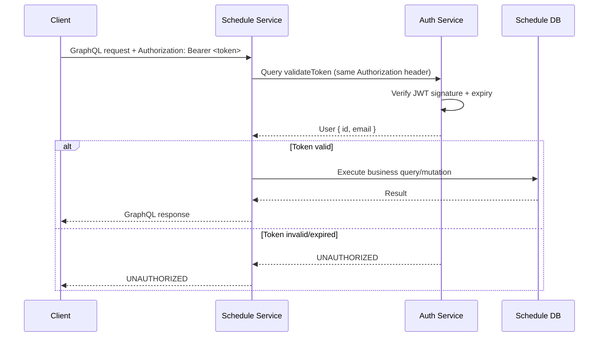
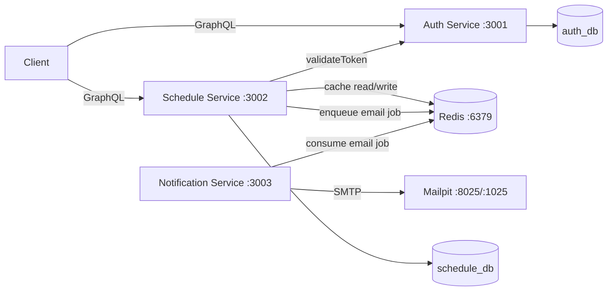

# Healthcare Scheduling System — Requirements & Acceptance Criteria

> Source: `Technical Test Engineer ( Backend ).docx (1).pdf`
> Project: RATA Skill Test — Backend Engineer
> Execution: **single-day, production-grade delivery**
> Status: Planning (to be copied to `REQUIREMENTS.md` in the repo when implementation starts)

---

## 1. Project Overview

Build a **microservice-based Healthcare Scheduling System** that lets a clinic manage consultation schedules between doctors and patients (customers).

The system consists of **two mandatory, independently running services** that communicate over APIs:

1. **Auth Service** — authentication and user management (`:3001`)
2. **Schedule Service** — customer, doctor, and schedule management (`:3002`)

A third **Notification Service** (`:3003`) is added as an optional bonus worker (explicitly allowed by the brief).

---

## 2. Delivery Standard — Production-Grade, Not Prototype

The brief is the minimum. This delivery must look and behave like a small real product team's repository.

### 2.1 Repository & Process

- [ ] `README.md` with badges, quickstart, architecture, API, operations, troubleshooting.
- [ ] `CONTRIBUTING.md`, `CODEOWNERS`, `SECURITY.md`, `CHANGELOG.md`, `LICENSE`.
- [ ] PR template + issue templates.
- [ ] Conventional Commits enforced by commitlint + Husky.
- [ ] Branch protection documented for `main` and `develop`.
- [ ] Semantic versioning, release tags, and a release workflow.
- [ ] Dependabot/Renovate for dependency updates.
- [ ] Architecture Decision Records (`docs/adr/`) for every non-obvious choice.
- [ ] Explicit roadmap and non-goals (`docs/roadmap.md`).
- [ ] `.editorconfig`, `.nvmrc`, `.gitattributes`, `.npmrc`.

### 2.2 Engineering

- [ ] Strict TypeScript, ESLint, Prettier.
- [ ] Unit tests + e2e tests + Newman smoke suite + k6 load script.
- [ ] Coverage thresholds enforced in CI.
- [ ] CI: lint, test, coverage, build, Docker build, smoke, security scan.
- [ ] Multi-stage Dockerfiles, non-root users, healthchecks.
- [ ] Prisma migrations committed; `migrate deploy` on startup; idempotent seed.
- [ ] Backup/restore scripts and documented procedure.
- [ ] Structured logs with request IDs; sensitive fields redacted.
- [ ] `/metrics` endpoint and optional Prometheus/Grafana profile.
- [ ] Health/readiness endpoints; graceful shutdown on `SIGTERM`.
- [ ] Timeouts, retries, dead-letter queue, cache fallback.
- [ ] Helmet, CORS, rate limiting, GraphQL Armor, input validation.
- [ ] Audit log for schedule mutations.
- [ ] Redis cache with versioned invalidation.
- [ ] Committed GraphQL schema contracts.
- [ ] Postman collection with chained test scripts.
- [ ] `Makefile` + `scripts/` for developer and operator workflows.
- [ ] Environment schema validation at boot.
- [ ] Domain error codes, not generic 500s.

### 2.3 Architecture

- [ ] Clear service boundaries and data ownership.
- [ ] Database-per-service (two isolated databases).
- [ ] Auth delegation over a versioned GraphQL contract.
- [ ] Event-driven notification via BullMQ.
- [ ] No shared database, no cross-service joins.
- [ ] C4 context/container/component diagrams.
- [ ] Sequence diagrams for auth and schedule creation.
- [ ] Documented failure modes and scalability notes.

### 2.4 Operations

- [ ] One-command local stack.
- [ ] Mailpit for email inspection.
- [ ] Bull Board (or queue logs) for queue inspection.
- [ ] Runbooks for DB outage, queue backlog, cache outage, auth outage.
- [ ] Migration policy (expand/contract, no destructive migrations).
- [ ] Secret management policy.
- [ ] Release and rollback procedure.

---

## 3. Mandatory Tech Stack

| Component | Technology | Notes |
|---|---|---|
| Framework | **NestJS** | Use current stable NestJS 12.x |
| Database | **PostgreSQL** | One instance with two isolated databases is allowed |
| API | **GraphQL** | Code-first with Apollo Server |
| Container | **Docker & Docker Compose** | Must run with `docker compose up` |
| Architecture | **Microservice** | Independent services, API communication, database-per-service |
| ORM | **PrismaJS** | Prisma ORM 7.x with PostgreSQL driver adapter |

---

## 4. Auth Service (`:3001`)

### 4.1 Responsibilities

- User registration
- User login and JWT issuance
- Token validation for other services
- Password hashing with bcrypt

### 4.2 Required GraphQL Operations

| Operation | Type | Description |
|---|---|---|
| `register` | Mutation | Register a new user with email and password |
| `login` | Mutation | Authenticate and return an access token (JWT) |
| `validateToken` | Query | Validate the bearer token and return user info |

### 4.3 User Model

```prisma
model User {
  id        String   @id @default(uuid()) @db.Uuid
  email     String   @unique
  password  String   // bcrypt hash, never exposed via GraphQL
  createdAt DateTime @default(now())
  updatedAt DateTime @updatedAt
}
```

### 4.4 Auth Rules

- Password **must** be hashed with **bcrypt** before storage.
- JWT must have a **reasonable expiry** (default: `1h`, configurable via `JWT_EXPIRES_IN`).
- `validateToken` reads `Authorization: Bearer <token>` and returns the authenticated user.
- Invalid, missing, malformed, or expired tokens return an `UNAUTHORIZED` GraphQL error.
- Password is **never** returned by any GraphQL field.
- Registering an existing email returns `EMAIL_ALREADY_EXISTS`.
- Login with wrong credentials returns `INVALID_CREDENTIALS` (do not reveal whether email exists).

### 4.5 Auth GraphQL Contract (target)

```graphql
scalar DateTime

type User {
  id: ID!
  email: String!
  createdAt: DateTime!
  updatedAt: DateTime!
}

type AuthPayload {
  accessToken: String!
  user: User!
}

input RegisterInput {
  email: String!
  password: String!
}

input LoginInput {
  email: String!
  password: String!
}

type Query {
  """Validate the bearer token and return the authenticated user."""
  validateToken: User!
}

type Mutation {
  """Register a new user. Returns the user and an access token."""
  register(input: RegisterInput!): AuthPayload!

  """Authenticate with email/password and return an access token."""
  login(input: LoginInput!): AuthPayload!
}
```

### 4.6 Auth Acceptance Criteria

- [ ] `register` creates a user with a unique email and bcrypt-hashed password.
- [ ] `register` rejects duplicate emails with `EMAIL_ALREADY_EXISTS`.
- [ ] `login` returns a valid JWT for correct credentials.
- [ ] `login` rejects wrong email/password with `INVALID_CREDENTIALS`.
- [ ] `validateToken` returns the user for a valid token.
- [ ] `validateToken` rejects missing/invalid/expired tokens with `UNAUTHORIZED`.
- [ ] Password is never present in any GraphQL response.
- [ ] JWT expiry is configurable and documented.
- [ ] `GET /health` returns `200` when the service and database are healthy.

---

## 5. Schedule Service (`:3002`)

### 5.1 Responsibilities

- Customer CRUD
- Doctor CRUD
- Schedule CRUD
- Enforce schedule business rules
- Validate every request against the Auth Service

### 5.2 Authentication Requirement

**Every** Schedule Service GraphQL operation requires:

```http
Authorization: Bearer <token>
```

Flow:

1. Client calls Schedule Service with the bearer token.
2. Schedule Service calls Auth Service `validateToken`.
3. If valid, the request continues with the authenticated user in context.
4. If invalid, return `UNAUTHORIZED`.

### 5.3 Customer Module

| Operation | Type | Description |
|---|---|---|
| `createCustomer` | Mutation | Create a customer |
| `updateCustomer` | Mutation | Update customer data |
| `customers` | Query | List customers with pagination |
| `customer` | Query | Get a customer by ID |
| `deleteCustomer` | Mutation | Delete a customer |

```prisma
model Customer {
  id        String     @id @default(uuid()) @db.Uuid
  name      String
  email     String     @unique
  createdAt DateTime   @default(now())
  updatedAt DateTime   @updatedAt
  schedules Schedule[]
}
```

### 5.4 Doctor Module

| Operation | Type | Description |
|---|---|---|
| `createDoctor` | Mutation | Create a doctor |
| `updateDoctor` | Mutation | Update doctor data |
| `doctors` | Query | List doctors with pagination |
| `doctor` | Query | Get a doctor by ID |
| `deleteDoctor` | Mutation | Delete a doctor |

```prisma
model Doctor {
  id        String     @id @default(uuid()) @db.Uuid
  name      String
  createdAt DateTime   @default(now())
  updatedAt DateTime   @updatedAt
  schedules Schedule[]
}
```

### 5.5 Schedule Module

| Operation | Type | Description |
|---|---|---|
| `createSchedule` | Mutation | Create a schedule |
| `schedules` | Query | List schedules with filters and pagination |
| `schedule` | Query | Get a schedule by ID |
| `deleteSchedule` | Mutation | Delete a schedule |

```prisma
model Schedule {
  id          String   @id @default(uuid()) @db.Uuid
  objective   String
  customerId  String   @db.Uuid
  doctorId    String   @db.Uuid
  scheduledAt DateTime
  createdAt   DateTime @default(now())
  updatedAt   DateTime @updatedAt

  customer Customer @relation(fields: [customerId], references: [id], onDelete: Restrict)
  doctor   Doctor   @relation(fields: [doctorId], references: [id], onDelete: Restrict)

  @@unique([doctorId, scheduledAt], name: "schedule_doctor_time_unique")
  @@index([customerId])
  @@index([scheduledAt])
}
```

### 5.6 Schedule Business Rules

- **No double-booking:** the same doctor cannot have two schedules at the same `scheduledAt`.
  - Enforced in the application **and** by a database unique constraint to survive races.
  - Conflict returns `SCHEDULE_CONFLICT`.
- **Customer must exist:** otherwise `CUSTOMER_NOT_FOUND`.
- **Doctor must exist:** otherwise `DOCTOR_NOT_FOUND`.
- `scheduledAt` is stored in UTC and returned as ISO-8601.
- Deleting a customer/doctor with existing schedules is rejected with `CUSTOMER_HAS_SCHEDULES` / `DOCTOR_HAS_SCHEDULES` (data integrity).
- All list queries support pagination; schedules also support filters.

### 5.7 Pagination Contract

```graphql
input PaginationInput {
  page: Int = 1     # 1-based, min 1
  limit: Int = 10   # min 1, max 100
}

type PageInfo {
  page: Int!
  limit: Int!
  total: Int!
  totalPages: Int!
  hasNextPage: Boolean!
  hasPreviousPage: Boolean!
}

type CustomerConnection {
  items: [Customer!]!
  pageInfo: PageInfo!
}
```

### 5.8 Schedule Filters

```graphql
input ScheduleFilterInput {
  doctorId: ID
  customerId: ID
  from: DateTime
  to: DateTime
  search: String   # matches objective, case-insensitive
}
```

### 5.9 Schedule GraphQL Contract (target)

```graphql
scalar DateTime

type Customer {
  id: ID!
  name: String!
  email: String!
  createdAt: DateTime!
  updatedAt: DateTime!
}

type Doctor {
  id: ID!
  name: String!
  createdAt: DateTime!
  updatedAt: DateTime!
}

type Schedule {
  id: ID!
  objective: String!
  customerId: ID!
  doctorId: ID!
  scheduledAt: DateTime!
  customer: Customer!
  doctor: Doctor!
  createdAt: DateTime!
  updatedAt: DateTime!
}

input CreateCustomerInput { name: String! email: String! }
input UpdateCustomerInput { name: String email: String }

input CreateDoctorInput { name: String! }
input UpdateDoctorInput { name: String }

input CreateScheduleInput {
  objective: String!
  customerId: ID!
  doctorId: ID!
  scheduledAt: DateTime!
}

input PaginationInput { page: Int = 1 limit: Int = 10 }
input CustomerFilterInput { search: String email: String }
input DoctorFilterInput { search: String }
input ScheduleFilterInput {
  doctorId: ID
  customerId: ID
  from: DateTime
  to: DateTime
  search: String
}

type PageInfo {
  page: Int!
  limit: Int!
  total: Int!
  totalPages: Int!
  hasNextPage: Boolean!
  hasPreviousPage: Boolean!
}

type CustomerConnection { items: [Customer!]! pageInfo: PageInfo! }
type DoctorConnection { items: [Doctor!]! pageInfo: PageInfo! }
type ScheduleConnection { items: [Schedule!]! pageInfo: PageInfo! }

type Query {
  customers(filter: CustomerFilterInput, pagination: PaginationInput): CustomerConnection!
  customer(id: ID!): Customer
  doctors(filter: DoctorFilterInput, pagination: PaginationInput): DoctorConnection!
  doctor(id: ID!): Doctor
  schedules(filter: ScheduleFilterInput, pagination: PaginationInput): ScheduleConnection!
  schedule(id: ID!): Schedule
}

type Mutation {
  createCustomer(input: CreateCustomerInput!): Customer!
  updateCustomer(id: ID!, input: UpdateCustomerInput!): Customer!
  deleteCustomer(id: ID!): Customer!

  createDoctor(input: CreateDoctorInput!): Doctor!
  updateDoctor(id: ID!, input: UpdateDoctorInput!): Doctor!
  deleteDoctor(id: ID!): Doctor!

  createSchedule(input: CreateScheduleInput!): Schedule!
  deleteSchedule(id: ID!): Schedule!
}
```

### 5.10 Schedule Acceptance Criteria

- [ ] All customer/doctor/schedule operations require a valid bearer token.
- [ ] Invalid/missing token returns `UNAUTHORIZED`.
- [ ] Customer create/update/list/get/delete works with pagination.
- [ ] Customer email uniqueness is enforced.
- [ ] Doctor create/update/list/get/delete works with pagination.
- [ ] Schedule create validates customer and doctor existence.
- [ ] Schedule create rejects doctor double-booking with `SCHEDULE_CONFLICT`.
- [ ] `schedules` supports `doctorId`, `customerId`, `from`, `to`, and `search` filters.
- [ ] All lists return `items` + `pageInfo` with correct totals.
- [ ] `schedule` returns nested `customer` and `doctor` without N+1 queries.
- [ ] Deleting a referenced customer/doctor returns a clear conflict error.
- [ ] Deleting a schedule sends an email notification (bonus).
- [ ] `GET /health` returns `200` when the service, database, and Redis are healthy.

---

## 6. Inter-Service Authentication

### 6.1 Sequence



### 6.2 Error Behavior

| Condition | GraphQL error code | HTTP status (if applicable) |
|---|---|---|
| Missing/malformed token | `UNAUTHORIZED` | 200 with GraphQL error |
| Invalid/expired token | `UNAUTHORIZED` | 200 with GraphQL error |
| Auth Service unreachable/timeout | `AUTH_SERVICE_UNAVAILABLE` | 503 |
| Auth Service returns malformed response | `AUTH_SERVICE_UNAVAILABLE` | 503 |

- Schedule Service **does not** share the JWT secret. It trusts only Auth Service validation.
- Inter-service call has a configurable timeout (default `2000ms`).

---

## 7. Docker Requirements

`docker-compose.yml` must include:

- [ ] `postgres` container
- [ ] `redis` container (bonus)
- [ ] `mailpit` container (bonus, email inspection)
- [ ] `auth-service` container
- [ ] `schedule-service` container
- [ ] `notification-service` container (bonus)
- [ ] Shared Docker network
- [ ] Named volumes for persistent data
- [ ] Healthchecks for all stateful and application containers
- [ ] `depends_on` with health conditions
- [ ] Environment-variable-driven configuration
- [ ] Automatic Prisma migrations on startup
- [ ] Optional idempotent demo seed on startup

### 7.1 One-Command Run

```bash
cp .env.example .env
docker compose up --build
```

Expected endpoints:

| URL | Purpose |
|---|---|
| `http://localhost:3001/graphql` | Auth GraphiQL |
| `http://localhost:3002/graphql` | Schedule GraphiQL |
| `http://localhost:3003/health` | Notification health |
| `http://localhost:8025` | Mailpit UI |

### 7.2 Secrets

- No credentials or secrets committed.
- `.env.example` contains placeholders only.
- `.env` is git-ignored.
- `JWT_SECRET` is required and has no insecure production default.

---

## 8. Bonus Features — All In Scope

| Bonus | Points | Requirement | Acceptance Criteria |
|---|---:|---|---|
| Email Notification | +15 | Send email to customer when a schedule is created or deleted | Email visible in Mailpit for both events, with schedule details |
| Queue System | +10 | Use Bull queue for email sending | BullMQ queue + worker, retries/backoff, failed-job retention, async (request does not block on SMTP) |
| Caching | +10 | Redis caching for query optimization | Read queries cached with TTL; mutations invalidate; graceful fallback if Redis is down |
| Unit Testing | +10 | Minimum 50% code coverage | Per-service Jest coverage >= 50% (target 80%+), CI publishes coverage |
| API Documentation | +5 | GraphQL Playground with complete descriptions | GraphiQL enabled, every type/field/argument described, `schema.gql` committed, README + Postman examples |

### 8.1 Bonus Architecture



### 8.2 Email Events

**On schedule create:**
- To: customer email
- Subject: `Schedule Confirmed — <date/time>`
- Body: customer name, doctor name, objective, scheduledAt, schedule ID

**On schedule delete:**
- To: customer email
- Subject: `Schedule Cancelled — <date/time>`
- Body: same details plus cancellation notice

---

## 9. Expected Project Structure

```text
healthcare-scheduling/
├── .github/
│   ├── CODEOWNERS
│   ├── dependabot.yml
│   ├── pull_request_template.md
│   ├── ISSUE_TEMPLATE/
│   └── workflows/
│       ├── ci.yml
│       ├── smoke.yml
│       ├── security.yml
│       ├── release.yml
│       └── commitlint.yml
├── .editorconfig
├── .env.example
├── .gitattributes
├── .gitignore
├── .dockerignore
├── .nvmrc
├── .npmrc
├── CHANGELOG.md
├── CODEOWNERS
├── CONTRIBUTING.md
├── LICENSE
├── Makefile
├── README.md
├── SECURITY.md
├── docker-compose.yml
├── docker-compose.override.yml
├── docker-compose.prod.yml
├── docker-compose.observability.yml
├── docs/
│   ├── architecture.md
│   ├── api.md
│   ├── operations.md
│   ├── security.md
│   ├── testing.md
│   ├── performance.md
│   ├── roadmap.md
│   ├── adr/
│   │   ├── 0001-record-architecture-decisions.md
│   │   ├── 0002-use-nestjs-graphql-prisma.md
│   │   ├── 0003-database-per-service.md
│   │   ├── 0004-auth-delegation-via-graphql.md
│   │   ├── 0005-bullmq-for-async-email.md
│   │   ├── 0006-redis-cache-strategy.md
│   │   ├── 0007-restrict-deletes-for-scheduling-integrity.md
│   │   └── 0008-pin-prisma-7-not-8-rc.md
│   └── runbooks/
│       ├── database-outage.md
│       ├── queue-backlog.md
│       ├── cache-outage.md
│       └── auth-service-outage.md
├── contracts/
│   ├── auth.graphql
│   └── schedule.graphql
├── infra/
│   ├── docker/postgres/init.sql
│   ├── redis/redis.conf
│   ├── prometheus/prometheus.yml
│   └── grafana/
├── postman/
│   ├── Healthcare-Scheduling.postman_collection.json
│   ├── Healthcare-Scheduling.postman_environment.json
│   └── README.md
├── scripts/
│   ├── bootstrap.sh
│   ├── wait-for-health.sh
│   ├── smoke.sh
│   ├── reset-db.sh
│   ├── seed.sh
│   ├── db-backup.sh
│   ├── db-restore.sh
│   ├── generate-contracts.sh
│   └── load-test.js
├── auth-service/
│   ├── Dockerfile
│   ├── docker-entrypoint.sh
│   ├── package.json
│   ├── package-lock.json
│   ├── prisma/schema.prisma
│   ├── prisma/migrations/
│   ├── prisma/seed.ts
│   ├── prisma.config.ts
│   ├── src/
│   └── test/
├── schedule-service/
│   ├── Dockerfile
│   ├── docker-entrypoint.sh
│   ├── package.json
│   ├── package-lock.json
│   ├── prisma/schema.prisma
│   ├── prisma/migrations/
│   ├── prisma/seed.ts
│   ├── prisma.config.ts
│   ├── src/
│   └── test/
└── notification-service/
    ├── Dockerfile
    ├── docker-entrypoint.sh
    ├── package.json
    ├── package-lock.json
    ├── src/
    ├── templates/
    └── test/
```

---

## 10. Deliverables

1. **Source code** pushed to GitHub.
2. **README.md** containing:
   - How to run the project
   - Architecture diagram (Mermaid C4 + sequence diagrams)
   - Environment variable list
   - GraphQL query/mutation examples
   - Testing and coverage instructions
   - Design decisions and trade-offs
   - Operations and troubleshooting
3. **Production documentation set:**
   - `docs/architecture.md`
   - `docs/api.md`
   - `docs/operations.md`
   - `docs/security.md`
   - `docs/testing.md`
   - `docs/performance.md`
   - `docs/roadmap.md`
   - `docs/adr/0001`–`0008`
   - `docs/runbooks/*`
   - `contracts/auth.graphql`, `contracts/schedule.graphql`
4. **Postman Collection** with:
   - Auth, Customer, Doctor, Schedule folders
   - Environment variables
   - Test scripts that save `token`, `customerId`, `doctorId`, `scheduleId`
5. **Tests** with coverage report, Newman smoke suite, and k6 load script.
6. **CI/CD** workflows for lint, test, coverage, build, smoke, security scan, and release.
7. **No committed secrets.**
8. **Release tag** `v1.0.0` with changelog.

---

## 11. Scoring Rubric Mapping

| Aspect | Weight | How this plan addresses it | Evidence |
|---|---:|---|---|
| Functionality | 30% | Every required operation + validation + conflict rules | Postman/Newman suite, e2e tests, demo script |
| Code Quality | 25% | Strict TypeScript, ESLint/Prettier, repository layer, DTOs, small modules, consistent naming | `npm run lint`, PR reviews, structure |
| Architecture | 20% | Two independent services, database-per-service, GraphQL contracts, auth delegation, event-driven notification, Redis cache | Mermaid diagrams, compose topology, module boundaries |
| Docker Setup | 15% | Multi-stage builds, non-root, healthchecks, migrations, seed, one-command up | `docker compose up --build` demo |
| Documentation | 10% | README, architecture/sequence diagrams, env table, GraphQL examples, Postman, troubleshooting | Docs review |
| Bonus Features | +50% | All five bonuses implemented and tested | Mailpit screenshot, BullMQ dashboard/logs, coverage report, GraphiQL |

---

## 12. Non-Functional Requirements

### 12.1 Security

- bcrypt password hashing (cost >= 10, default 12).
- JWT signed with a strong secret; expiry enforced.
- No password in logs or GraphQL responses.
- Helmet security headers.
- CORS configurable via env.
- GraphQL query depth/cost/alias limits (GraphQL Armor).
- Input validation on every mutation (class-validator).
- No secrets committed; `.env` ignored.
- Non-root Docker users.

### 12.2 Validation & Error Handling

- Consistent GraphQL error `extensions.code` values.
- Human-readable messages.
- Prisma errors mapped to domain errors (P2002, P2003, P2025).
- No stack traces or internal details leaked in production.

### 12.3 Observability

- Structured JSON logs with request IDs.
- Health endpoints for each service.
- `/metrics` Prometheus endpoint per service.
- Graceful shutdown (`SIGTERM`/`SIGINT`).
- Startup logs include service name, port, and environment.
- Sensitive fields (`authorization`, `password`, customer email) are redacted.

### 12.4 Performance

- Pagination enforced with a max `limit` of 100.
- Nested schedule customer/doctor loaded with `include` (no N+1).
- Indexes on foreign keys and `scheduledAt`.
- Redis cache for read-heavy queries.
- Email sending is asynchronous (queue).

### 12.5 Code Quality

- TypeScript strict mode.
- No `any` in application code (except unavoidable library boundaries).
- ESLint + Prettier.
- Conventional Commits.
- Unit tests for services, guards, repositories, and processors.

### 12.6 Operations

- One-command local stack: `docker compose up --build`.
- `/health` (liveness + readiness) and `/metrics` on every service.
- `prisma migrate deploy` runs at container start; migrations are committed and reviewed.
- Idempotent demo seed controlled by `SEED_DEMO_DATA`.
- Backup and restore scripts (`scripts/db-backup.sh`, `scripts/db-restore.sh`).
- Runbooks for DB outage, queue backlog, cache outage, and Auth Service outage.
- Environment schema validated at boot; the service fails fast on misconfiguration.
- Graceful shutdown closes Prisma, Redis, and BullMQ connections.
- Migration policy: expand/contract only; no destructive migration in the same release as the code that stops using the old shape.
- Secret management policy: `.env` is local-only, `.env.example` is committed, production secrets come from the platform secret store.

### 12.7 Release & Versioning

- Semantic Versioning (`MAJOR.MINOR.PATCH`).
- Lightweight Git Flow: `main`, `develop`, `feature/*`, `fix/*`, `chore/*`, `docs/*`, `test/*`, `release/*`, `hotfix/*`.
- Conventional Commits enforced by commitlint.
- Branch protection on `main` and `develop` (PR required, status checks required, no force push).
- `CHANGELOG.md` maintained per release.
- Tag `v1.0.0` for the delivered version.
- Release workflow publishes container images to GHCR with an SBOM and provenance.
- Rollback: redeploy the previous image tag and run only backward-compatible migrations.

### 12.8 Non-Goals (Documented in `docs/roadmap.md`)

- Transactional outbox for guaranteed email delivery (queue failure currently logs and continues).
- Distributed tracing (OpenTelemetry + Jaeger).
- Kubernetes/Helm deployment manifests.
- RBAC and multi-tenant authorization.
- Soft deletes and healthcare record archival.
- GraphQL subscriptions / real-time updates.
- Cursor-based pagination.
- PgBouncer, read replicas, and multi-region deployment.
- Sentry or another hosted error tracker.
- Idempotency keys for create mutations.

These are deliberate scope boundaries, not oversights. Each has a documented next step.

---

## 13. Assumptions & Decisions

1. **One Postgres instance, two databases** (`auth_db`, `schedule_db`) — allowed by the brief and demonstrates data ownership without running two Postgres containers.
2. **Doctor conflict = exact same `scheduledAt`** — the schema has no duration field, so overlap cannot be computed. This is documented.
3. **Hard delete** for entities; deleting a referenced customer/doctor is rejected to preserve integrity.
4. **Notification Service is a bonus third service** — the brief explicitly allows adding a notification service for bonus features.
5. **GraphiQL replaces GraphQL Playground** — `@nestjs/graphql` v14 removed the old Playground; GraphiQL is the official replacement.
6. **Register returns a token** in addition to the user, for convenience. Login remains the canonical token endpoint.
7. **No refresh tokens, roles, or authorization scopes** — not required by the brief.
8. **No frontend** — GraphQL API only.
9. **Demo seed data** is idempotent and can be disabled with `SEED_DEMO_DATA=false`.

---

## 14. Final Acceptance Checklist

### Functional
- [ ] Auth register/login/validateToken work end-to-end.
- [ ] Schedule service rejects unauthenticated requests.
- [ ] Customer CRUD + pagination works.
- [ ] Doctor CRUD + pagination works.
- [ ] Schedule CRUD + filters + pagination works.
- [ ] Doctor double-booking is impossible.
- [ ] Invalid customer/doctor IDs are rejected.
- [ ] Nested customer/doctor returned on schedules.

### Bonus
- [ ] Email sent on schedule create (visible in Mailpit).
- [ ] Email sent on schedule delete (visible in Mailpit).
- [ ] BullMQ queue processes jobs asynchronously with retries.
- [ ] Redis cache hits/misses observable; invalidation works.
- [ ] Unit test coverage >= 50% (target 80%+).
- [ ] GraphiQL has descriptions for every operation and field.

### Delivery
- [ ] `docker compose up --build` works from a clean clone.
- [ ] `.env.example` documents every variable.
- [ ] No secrets committed.
- [ ] README has run instructions, architecture diagram, env table, and GraphQL examples.
- [ ] Postman collection works.
- [ ] CI passes lint, tests, coverage, and build.
- [ ] Git history uses conventional commits and a clear branch strategy.
- [ ] `main` and `develop` are protected; PR flow documented.
- [ ] `v1.0.0` tag exists with a `CHANGELOG.md` entry.
- [ ] ADRs 0001–0008 are present and reviewed.
- [ ] Runbooks exist for DB, queue, cache, and Auth Service outages.
- [ ] `/metrics` is exposed and documented.
- [ ] `docs/roadmap.md` lists P2 non-goals with rationale.
- [ ] Backup and restore scripts work against the local stack.

---

## 15. Locked Technical Decisions

| Decision | Choice |
|---|---|
| Notification Service | Separate third service (`notification-service:3003`) |
| Prisma version | **7.10.1 stable** (not the Prisma 8 RC) |
| Redis caching | Direct **`ioredis@6`** with versioned keys |
| Branching model | **Lightweight Git Flow** (`main` + `develop` + feature branches) |
| Password hashing | Native **`bcrypt@6`** with multi-stage Docker build tools |
| Email inspection | **Mailpit** (`http://localhost:8025`) |
| GraphQL IDE | **GraphiQL** (official replacement for the removed Playground) |
| App module format | **CommonJS** with NestJS 12 + Node 24 + Jest 30 |
| Database topology | One PostgreSQL instance with **two databases** (`auth_db`, `schedule_db`) |
| Execution model | **Single-day, production-grade delivery** (no multi-day schedule) |
| Scope model | **P0 must ship, P1 should ship, P2 documented roadmap** |
