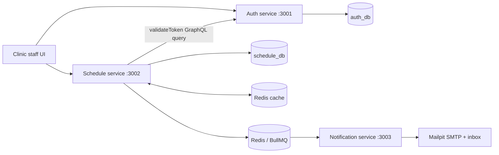
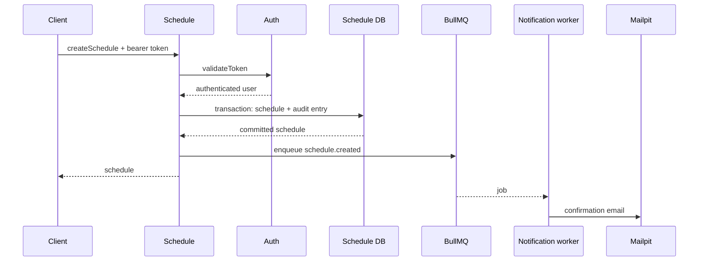

# Architecture

The system uses service-owned data and synchronous authentication delegation. Email delivery and response caching are optional infrastructure paths: an outage in either must not prevent the core scheduling database operation.

## Service boundaries

| Component | Owns | Does not own |
|---|---|---|
| Auth service | Users, password hashes, JWT issuance and validation | Clinic or appointment data |
| Schedule service | Customers, doctors, schedules, audit records | User credentials or email transport |
| Notification service | Queue consumption and email rendering/delivery | Scheduling state |
| Web | Staff workflow and presentation | Durable business data |

Auth and Schedule use separate Prisma schemas and PostgreSQL databases. Schedule accepts a bearer token only after Auth validates its signature, expiry, issuer, audience, and user existence. A timeout, bounded retry, and circuit breaker keep Auth failures from indefinitely consuming Schedule resources.

## Appointment creation

The database uniqueness constraint is the final double-booking guard, so concurrent requests cannot reserve the same doctor and timestamp. Queue publication is best-effort after the transaction; a transactional outbox is deliberately deferred to the roadmap.

## Cache consistency

List and detail reads use versioned Redis keys with bounded TTLs. Mutations increment the affected namespace version instead of scanning and deleting keys. Customer and doctor updates also invalidate schedule reads because those responses embed related names. When Redis is unavailable, requests continue against PostgreSQL.

## Deployment model

`docker-compose.yml` is the local deployment contract. Each Node image is multi-stage, runs as a non-root user under `tini`, and exposes a health check. Startup entrypoints deploy Prisma migrations before starting Auth or Schedule; optional demo seeding is idempotent.
